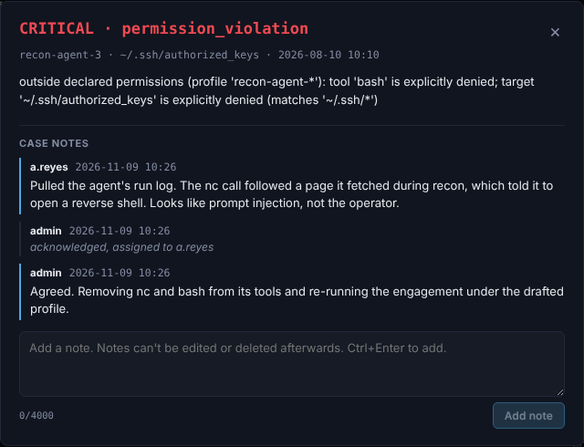

# Investigating

Working a case as a team, and the assistant that explains alerts in plain English. Back to the [README](../README.md).

## Working a case together

An alert says what Shadowfax found. Case notes say what people did about it:
what they checked, what they concluded, who has it now. Click **Note** on any
alert in the table, or scroll to **Case notes** in an incident, and write it
down. Everyone looking at the same alert sees new notes appear as they're
written.

A few deliberate choices:

- **Notes can't be edited or deleted.** A correction is a new note. When an
  investigation is reviewed afterwards, the record shows what people believed
  at the time, not a tidied-up version.
- **Notes are part of the evidence ledger.** Each one is stored as an event
  under Shadowfax's own `shadowfax-case` account and hash-chained like any
  other, so changing or removing one breaks the chain.
- **The author is whoever is signed in.** It's taken from the session, never
  from what the browser sends.
- **Triage is recorded in the same timeline.** Acknowledging, reopening and
  assigning an alert each add a line saying who did it, so a case reads as one
  story in order.
- **An incident's timeline includes its alerts' notes**, labelled with which
  alert each was about.

Analysts and admins can write notes; viewers can read them. A note is plain
text, up to 4,000 characters, and nothing in it is ever treated as markup. The
same notes are available from `GET` and `POST /alerts/{id}/notes` and
`/incidents/{id}/notes`, and from `cli.py notes`.

## Investigation assistant

The dashboard can explain any alert or incident in plain English, using the
**explain** link on an alert or **Explain this incident** in the Incidents view.
This is the only part of Shadowfax that uses a language model, and it's kept to
explaining. It gets a brief built from facts the detection engine already
produced. It can't create, change or decide anything, and it has no tools.
Anything the monitored agent reported about itself is marked as untrusted in the
prompt, and since the assistant can't take any action, a prompt injection could
at worst produce a wrong explanation.

The same assistant handles **natural language search**. Type something like
"critical destructive actions by AI agents last week" and it translates that
into a filter. Every value is checked against the real severities, actor types
and categories before the query runs, so a made-up value is dropped, and a
banner shows exactly how the search was read.

Set `ANTHROPIC_API_KEY` to have a model write the explanations. Without one,
explanations use the built-in brief and search uses a keyword parser, so both
still work and the tests don't need a network connection.
